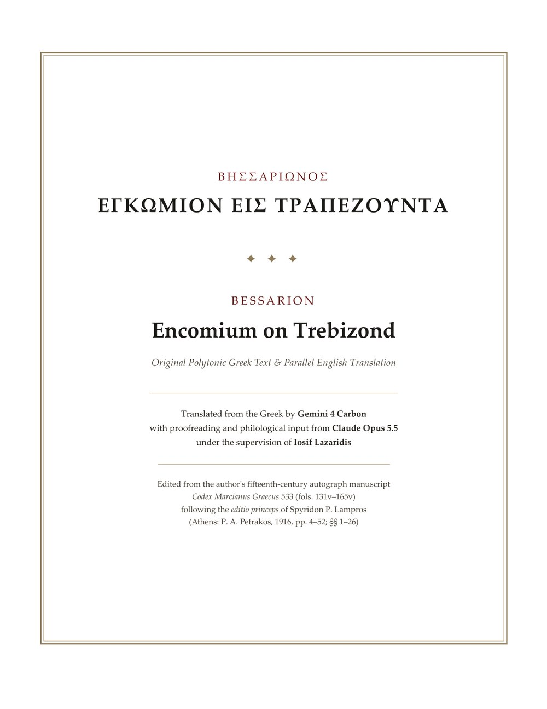

# Bessarion, Encomium on Trebizond

Βησσαρίωνος Ἐγκώμιον εἰς Τραπεζοῦντα: the Greek text and an English translation, side by side (PDF, 57 pages).

**Open the page:** https://iosiflazaridis.github.io/bessarion-encomium/  
**Download the PDF:** [Bessarion_Encomium_on_Trebizond.pdf](Bessarion_Encomium_on_Trebizond.pdf)

- **Greek text:** Sp. P. Lampros, *Βησσαρίωνος Ἐγκώμιον εἰς Τραπεζοῦντα* (Athens 1916), pp. 4–52, the first edition, from the author's autograph, Codex Marcianus Graecus 533, fols. 131v–165v ([scan of the 1916 edition](https://archive.org/details/bssarinsenkmione00bssa)).
- **Translation:** from the Greek by Gemini 4 Carbon, with proofreading and philological input from Claude Opus 5.5, under the supervision of Iosif Lazaridis ([@iosif_lazaridis](https://x.com/iosif_lazaridis)).
- **Layout:** 26 sections, Greek and English in parallel columns, with Lampros's page numbers.

The page uses the EB Garamond typeface, included under the SIL Open Font License (`fonts/OFL.txt`).
